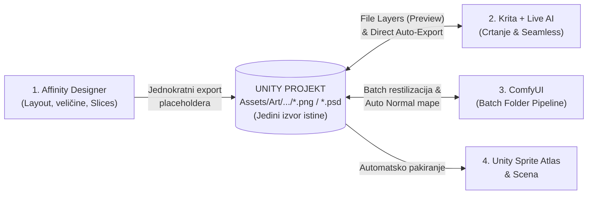

# Projekt Otok – Art Pipeline

## 1. Rezolucija i Kamera
- **Ciljana baza (Mockup / Export rezolucija):** `3840 × 2160 px` (4K) — `2×` u odnosu na ciljani FHD (`1920 × 1080 px`).
- **Zoom-in podrška:** Do `2×` zoom-in (pri čemu FHD prikazuje omjer piksela `1:1` na `Mip 0`).
- **Pixels Per Unit (PPU) i Kamera:**
  - Referentni PPU: `200 PPU` (uz `Orthographic Size = 5.4` / `10.8 unita` visine ekrana) ili `216 PPU` (uz `Orthographic Size = 5.0` / `10 unita` visine ekrana).

---

## 2. Vizualni stil i Animacija
- **Stil:** 2D (nije pixel art).
- **Sustav animacije:** Skeletalna animacija (ne koristi se frame-by-frame).
- **Tehnika skeletalne animacije (Mesh Deformation vs. Cutout):** `PENDING`

---

## 3. Render Pipeline i Slojevi (URP)
- **Render Pipeline:** Unity URP (Universal Render Pipeline 2D).
- **Raspored planova i paralakse:**
  - **Prednji plan (Foreground):** 1 – 2 plana
  - **Glavni plan (Main / Gameplay):** 1 plan
  - **Pozadina (Background Parallax):** do 8 planova

---

## 4. Sprite Atlas i Mipmapping postavke
- **Pojedinačni spriteovi:** Izvoze se obrezani (*cropped*) u prirodnim dimenzijama (ne moraju biti Po2).
- **Dimenzije Sprite Atlasa:** `Power of Two (Po2)` (npr. `2048 × 2048` ili `4096 × 4096`).
- **Postavke Sprite Atlasa:**
  - **Tight Packing:** `Enabled` *(izuzetak: 9-slice UI elementi i tileable spriteovi)*
  - **Allow Rotation:** `Disabled`
  - **Padding:** `8 px` *(minimalno `4 px` zbog mipmappinga kako bi se izbjegao texture bleeding)*
  - **Generate Mip Maps:** `Enabled`
  - **Filter Mode:** `Bilinear` ili `Trilinear` *(Trilinear preporučen za glatki prijelaz pri zoomiranju)*
  - **Mip Map Bias:** `-0.3` do `-0.5` *(po potrebi ako je slika premekana pri standardnom pogledu)*
  - **Kompresija (PC):** `BC7` (visoka kvaliteta) ili `DXT5`

---

## 5. Organizacija i Grupiranje Atlasa
1. **Player Atlas:** Zaseban atlas za glavnog lika i njegovu opremu/animacije.
2. **Enemy Atlasi:** Grupirano po biomima ili "rasama" (frakcijama). Popunjava se jedan atlas dok se ne napuni pa prelazi u novi, s ciljem da jedan biom u pravilu vuče samo 1 enemy atlas.
3. **Environment – Nadzemlje (Overworld):** Veliki atlas za nadzemni prostor i njegove planove paralakse.
4. **Environment – Podzemlje i Interijeri:** Grupirano po pojedinim biomima/zonama (1 atlas po biomu, s prelijevanjem u dodatni samo ako precuri).
5. **Items & Props Atlas:** Zajednički atlas za iteme, propse i sitne objekte u svijetu.
6. **GUI Atlas:** Zaseban atlas za sve sučelje *(Generate Mip Maps: `Disabled`, Tight Packing: `Disabled` za 9-slice elemente)*.
7. **VFX & Particles (Podjela u 3 kategorije):**
   - **Zašto odvojeno od Propsa:** Unity spaja objekte u isti *draw call* (batch) samo ako dijele **i isti Atlas i isti Materijal/Shader**. Propsi koriste `Sprite-Lit` materijal (i potencijalno Normal/Mask mape), dok većina VFX-a koristi `Unlit`, `Additive` ili custom *Particle* shadere. Stoga se ne mogu batchati zajedno, a držanje VFX-a u `Props` atlasu bi uzalud trošilo VRAM ako se na propse dodaju sekundarne teksture (Normal/Mask mape).
   - **A) Zaseban `VFX Atlas` (za većinu efekata):**
     - Sadrži pojedinačne sprajtove za Particle System i sprajt-efekte (dim, prašina, iskre, krv, *hit/slash* efekti, eksplozije).
     - Stalno učitan u memoriji; svi partikli s istim materijalom batchaju se zajedno.
   - **B) Zasebne Po2 teksture izvan atlasa (Shaders & Trails):**
     - Teksture koje zahtijevaju `Wrap Mode = Repeat` i čisti `0–1` UV prostor: *noise/dissolve/distortion* teksture koje se skrolaju u Shader Graphu, te teksture za `Trail Renderer` i `Line Renderer` (trag oružja, zrake, užad). U atlasu bi skrolanje UV koordinata prešlo na susjedne sprajtove.
   - **C) Fizičke krhotine (*Debris*) -> idu u `Items & Props Atlas` (ili atlas bioma):**
     - Komadići razbijenih objekata (kutije, vaze, kamenčići, lišće) koji koriste standardni `Sprite-Lit` materijal i primaju 2D rasvjetu scene ostaju u atlasu s propsima jer se s njima normalno batchaju.

---

## 6. Globalni Workflow i Pipeline izrade ("Unity Folder = Jedini Izvor Istine")

### Koraci u produkciji:
1. **Affinity Designer (Samo nacrt i inicijalizacija proporcija):**
   - Na `3840 × 2160 px` platnu definiraju se guideovi i grube siluete/blokovi objekata radi usklađivanja međusobnih omjera.
   - Kroz *Export Persona (Slices)* placeholderi se **jednokratno** izvoze direktno u odgovarajući Unity folder (`Assets/Art/...`). Od tog trenutka datoteke u Unity folderu su **jedini izvor istine** (*Single Source of Truth*) i mogu se odmah postavljati u scenu.
   - *Napomena:* Gotovi crteži iz Krite **ne vraćaju se u Affinity** radi izvoza, čime se eliminira suvišan međukorak.
2. **Krita + Live AI (Glavni alat za crtanje i Seamless teksture):**
   - **Preview kompozicija:** U Kriti se koristi master `.kra` datoteka u kojoj su PNG-ovi iz Unityja ubačeni kao **File Layers** (za pregled cijele scene i paralakse).
   - **Seamless teksture:** Krita *Wrap Around Mode (`W`)* koristi se za crtanje seamless tekstura terena i efekata.
   - **Custom Krita Python Plugin (Auto-Export za pojedinačne sprajtove):**
     - Omogućuje otvaranje izvornog radnog `.kra` filea iz *File Layera* u kompoziciji.
     - Pri spremanju (`Ctrl+S`), plugin automatski sprema radni `.kra` u *RawArt* arhivu (izvan Unity `Assets` foldera) i istovremeno gazi ciljani `.png` direktno u Unity projektu (čime se odmah osvježavaju i Krita Preview kompozicija i Unity scena).
3. **Workflow za likove i Skeletalnu animaciju (`.kra` -> Flatten Groups -> `.psd` -> Unity `2D PSD Importer`):**
   - Za višedijelne likove (15–30 dijelova tijela) koristi se Unityjev **2D PSD Importer** koji čita `.psd` datoteku, automatski odvaja layere u sprajtove, pakira ih u Sprite Atlas i zadržava im točnu poziciju u Prefabu za *rigging*.
   - **Custom 1-Click Krita PSD Exporter (Python skripta):**
     - Krita ugrađeni *Export Layers* plugin izvozi samo zasebne slikovne datoteke i ne radi *flatten* grupa u zajednički `.psd`.
     - Naš custom Krita Python alat na jedan klik:
       1. Klonira otvoreni `.kra` dokument u memoriji (`doc.clone()`) kako originalni radni `.kra` s pod-layerima, maskama i efektima ne bi bio uništen.
       2. U kopiji prolazi kroz sve **top-level grupe** (npr. `Glava`, `Torzo`, `Ruka_L`) i spaja svaku grupu u po jedan čisti *Paint Layer* (čime se Kritine specifične maske i blend modovi zapeču u čiste piksele kompatibilne s Unityjem).
       3. Izvozi privremeni dokument direktno u Unity projekt kao `.psd` (`doc.exportImage()`) i zatvara privremenu kopiju u memoriji.
4. **ComfyUI Batch Folder Pipeline (Restilizacija i post-processing):**
   - ComfyUI **ne obrađuje spakirane Unity atlase** (jer Unity `.spriteatlas` živi u *Library* cacheu i gubi se vizualni kontekst pojedinog objekta), već radi **Batch obradu nad folderom pojedinačnih PNG-ova** u Unity projektu (`Load Image Batch From Dir`).
   - Prebrisani PNG-ovi u Unity folderu automatski okidaju prepakiravanje Sprite Atlasa u Unityju bez gubitka pivota, kolizija ili referenci u sceni.

---

## 7. 2D Rasvjeta i Normal Mape (Bez ručnog crtanja)

Za URP 2D rasvjetu definirane su dvije opcije bez ručnog slikanja normal mapa:

### Opcija A: ComfyUI Batch "Auto-Normal" Pipeline (Poluautomatsko generiranje tekstura)
- ComfyUI workflow uzima folder gotovih PNG sprajtova iz Unityja i spaja:
  1. **Zaobljeni rub (*Bevel*) iz Alpha kanala** — daje cijelom sprajtu meki 3D volumen na rubovima.
  2. **AI Normal generator (*Marigold* / *Depth-Anything-V2 -> Normal*)** — izvlači plitke unutarnje detalje (kamen, drvo, nabori) iz same boje crteža.
- Sprema rezultat kao `ime_sprajta_n.png` uz original, a Unity Editor skripta ga automatski povezuje kao *Secondary Texture (`_NormalMap`)* u Sprite Atlasu.

### Opcija B: Custom URP Shader Graph (Bez Normal Map tekstura / 0 MB VRAM-a)
- Custom `Sprite-Lit` shader u URP Shader Graphu koji u realnom vremenu iz **Alpha kanala** (udaljenost od ruba sprajta za *Rim Light* / *Inner Bevel*) i **Luminance (svjetline/kontrasta)** bazne teksture izračunava pseudo-normalu kad pored sprajta prođe 2D svjetlo, bez generiranja dodatnih `_n.png` tekstura.

---

## 8. Izgradnja Terena i Gotova Rješenja u Unityju

### Odabir sustava za platforme: Spline-based (*Ori* stil)
- Umjesto klasičnog *Tilemapa*, primarno se koristi **Spline-based pristup** (**Unity `2D Sprite Shape`**) u kombinaciji s pobacanim pojedinačnim sprajtovima (*stamping* propsa/stijena/vegetacije).
- **Razlog:** U Kriti (*Wrap Around Mode*) dovoljno je nacrtati 1 seamless teksturu za unutrašnjost (*Fill*) i nekoliko seamless traka za rubove (*Edge* — trava, stijena, strop), dok Unity sam savija teksture duž Bezierovih krivulja i generira koliziju.

### Pregled službenih Unity paketa i Asset Store rješenja za pipeline:
1. **Teren i Platforme:**
   - **Unity `2D Sprite Shape` (Službeni besplatni paket):** Primarni alat za spline platforme, *Fill* + *Edge* seamless teksture i automatske 2D kolizije; nativno podržava URP 2D i Sprite Atlase.
   - *(Alternativa na Asset Storeu: **Ferr2D Terrain Tool** ili **Spline Terrain 2D**, ako zatreba specifično vertex-color sjenčanje rubova).*
2. **Skeletalna Animacija i Sekundarna Fizika:**
   - **Unity `2D Animation` + `2D IK` + `2D PSD Importer` (Službeni besplatni paketi):** Kostur, *mesh deformation*, IK kontroleri za noge/ruke i direktan uvoz slojeva iz našeg Krita `.psd` exportera.
   - **Asset Store za fiziku kostiju (*Secondary Motion*):** **Boing Kit** ili **Spring Bones / Dynamic Bone 2D** — za automatsko njihanje plašta, kose, opreme, lanaca i grana pri kretanju bez ručnog animiranja.
3. **Osvjetljenje, Shader Efekti i Atmosfera (Magla / God Rays):**
   - **URP 2D Lights (Službeni ugrađeni sustav):** `Freeform Light 2D`, `Sprite Light 2D` i `Shadow Caster 2D`.
   - **All In 1 Sprite Shader (Asset Store):** Gotova kolekcija optimiziranih 2D shadera (*Rim Light, Hit Flash, Glow/Bloom, Dissolve, Wind/Sway za vegetaciju, Water Reflection*) koja štedi vrijeme izrade vlastitih Shader Graphova.
   - **Volumetric Fog & Mist 2 (by Kronnect) ili HAZE (Asset Store):** Za slojevitu atmosfersku maglu i snopove svjetla (*god rays*) u URP-u između planova paralakse.
   - **Smart Lighting 2D (Asset Store - opcionalno):** Ako zatrebaju naprednije meke 2D sjene i maskiranje svjetla po obliku sprajta izvan standardnog URP 2D sustava.
4. **Kamera, Paralaksa i Game Feel:**
   - **Unity `Cinemachine` (Službeni besplatni paket):** Upravljanje kamerom, granice prostorija (*Confiner 2D*) i glatki **2× Zoom-in / Zoom-out** prijelazi.
   - **FEEL (by More Mountains - Asset Store):** Gotov sustav za *combat juice* (hit-stop, camera shake, bljesak sprajta pri udarcu, upravljanje česticama i zvukom).

> **TODO / Napomena za Asset Store:** Pretražiti i detaljno istražiti Unity Asset Store za navedene kategorije (posebice alate za *spline-based* platforme, *secondary motion* fiziku kostiju, 2D osvjetljenje/volumetrijsku maglu i gotove 2D URP shadere) prije izrade vlastitih custom rješenja.

---

## 9. Art Pipeline – To Do

1. **Odrediti veličinu lika na ekranu i točan broj Unita po visini ekrana** (definirati omjer glavnog lika u odnosu na `3840 × 2160 px` ekran, npr. `10 unita` uz `216 PPU` ili `10.8 unita` uz `200 PPU`).
2. **Donijeti odluku za tehniku skeletalne animacije:** *Mesh Deformation* vs. *Cutout* (ili hibridni pristup).
3. **Pretražiti i evaluirati Unity Asset Store rješenja:**
   - Spline-based platforme (usporediti ugrađeni `2D Sprite Shape` s Asset Store alatima).
   - Fizika kostiju (*Secondary Motion* za plašt, kosu i opremu — npr. *Boing Kit*, *Spring Bones*).
   - 2D URP shaderi i volumetrijska magla (*All In 1 Sprite Shader*, *Volumetric Fog & Mist 2* / *HAZE*, *Smart Lighting 2D*).
   - Combat juice i kamera efekti (*FEEL*).
4. **Odabrati i testirati pristup za 2D rasvjetu / Normal mape:**
   - Testirati *Opciju A* (ComfyUI Batch Auto-Normal generator) u usporedbi s *Opcijom B* (Custom URP Shader Graph bez normal tekstura).
5. **Definirati točnu strukturu foldera i konvenciju imenovanja** u Unity projektu (`Assets/Art/...`) i izvan njega (`RawArt/` za radne `.kra` i Affinity predloške).
6. **Izraditi custom Krita Python alate:**
   - **Auto-Export plugin za pojedinačne sprajtove** (`.kra` arhiva + direktan `.png` export u Unity i update *File Layer* kompozicije).
   - **1-Click `.psd` Exporter za likove** (kloniranje dokumenta u RAM-u -> *flatten* svih top-level grupa u layere -> export u `.psd` za Unity `2D PSD Importer`).
7. **Složiti ComfyUI Batch Folder workflow** za AI restilizaciju pojedinačnih PNG-ova po folderima.
8. **Postaviti Sorting Layere, paralaksu (1–2 forplana, glavni plan, do 8 planova pozadine) i `Cinemachine` kameru** s testnim `2×` zoom-inom u Unityju.

